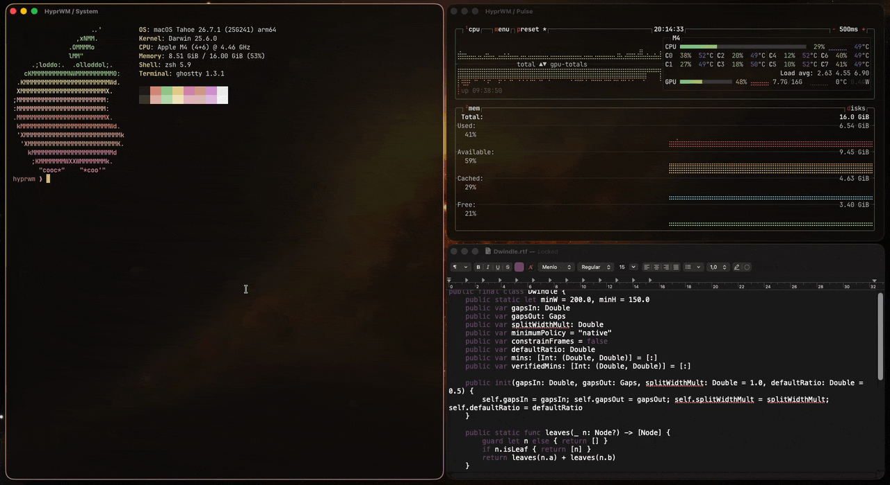
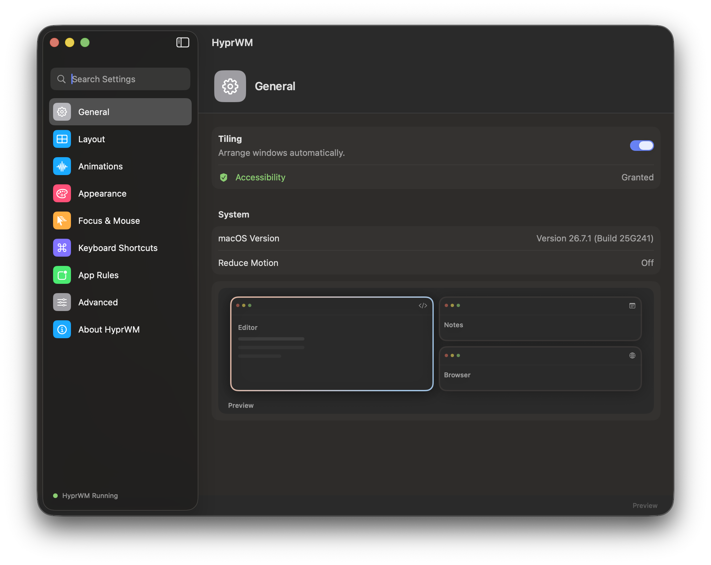
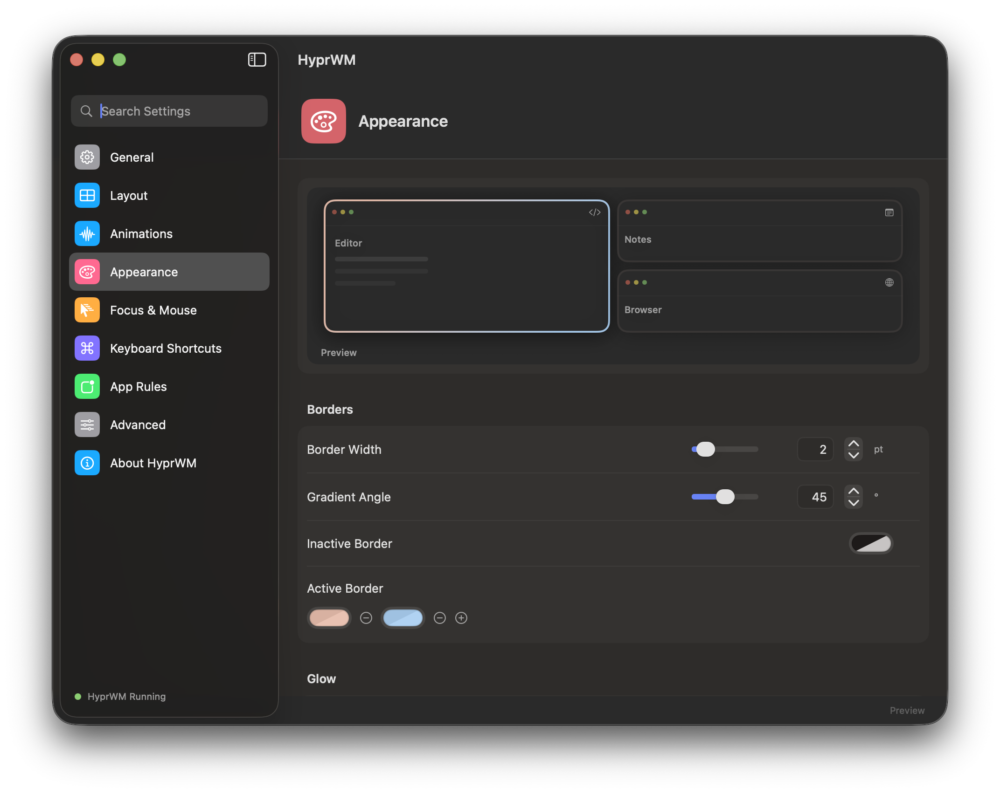
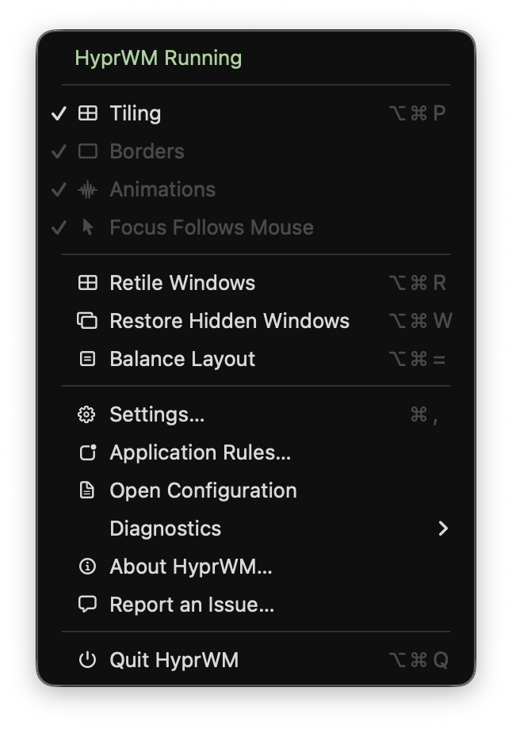
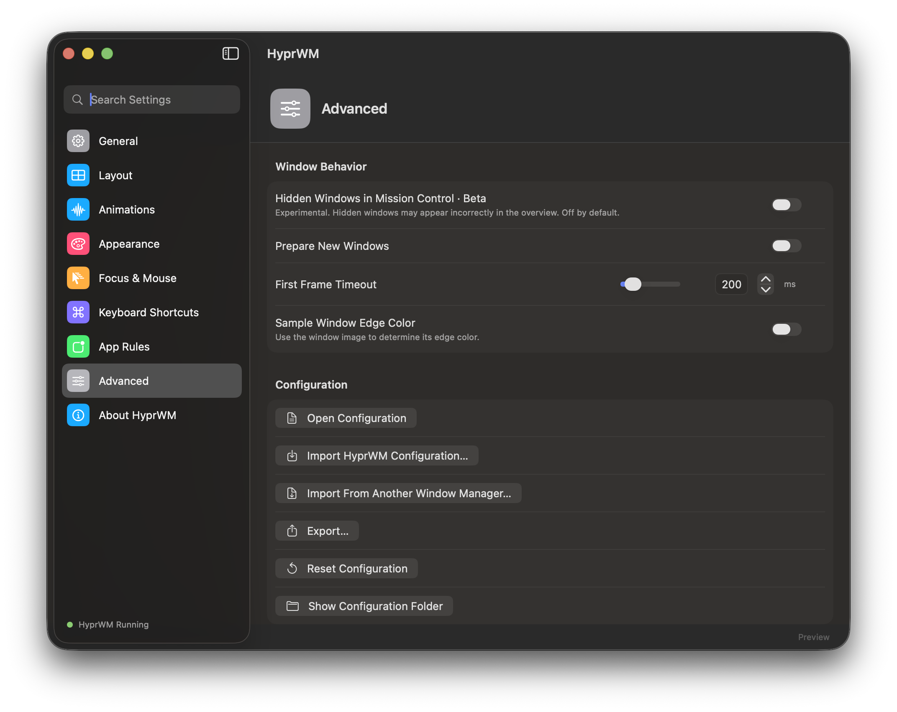

<h1 align="center">HyprWM</h1>

<p align="center">
  <a href="docs/media/showcase.mp4">
    
  </a>
</p>

<p align="center">
  Hyprland-style tiling for macOS: dwindle layout, keyboard control,<br>
  smooth animations and gradient borders.
</p>

> [!WARNING]
> **Experimental. Read before installing.**
> - Tiling requires the native engine, which runs inside WindowServer.
> - The engine supports only **macOS 26.7.1 (build 25G241), Apple silicon**.
>   Other builds are refused at startup.
> - It needs **System Integrity Protection (SIP) fully disabled**
>   and `sudo` for setup. Use a machine you are comfortable experimenting on.
> - Repeat native setup after every reboot or WindowServer restart.
> - A native-engine failure can disrupt your desktop. Save your work first.

## Features

- Dwindle tiling with adjustable gaps and split ratios.
- Keyboard commands for focus, moving windows, floating and fullscreen.
- Animated window opening, closing, movement and resizing.
- Gradient borders, rounded corners, shadows and glow.
- Focus follows mouse, with rules for individual applications.
- Menu bar controls and a SwiftUI Settings window.
- Text configuration with live reload and import from Hyprland and other WMs.
- Local `hyprwm` and `hyprwmctl` command-line tools.

Closing animations and some focus cases still need work. See [known issues](#status-and-known-issues).

## Screenshots

| Settings | Appearance |
| --- | --- |
|  |  |
|  |  |

[Watch the 48-second demo](docs/media/showcase.mp4) · [View the poster](docs/media/poster.png)

## Requirements

| What you want to do | What you need |
| --- | --- |
| Build the Swift app | macOS 14+, Xcode Command Line Tools (Swift 5.9+), Python 3 and Git. |
| Run with tiling | All of the above, **macOS 26.7.1 (25G241), Apple silicon, SIP fully disabled, and admin rights**. |
| Rebuild a Hyprland Lua configuration in a source checkout | Optional: `lua` (`brew install lua`). The installed app does not need Lua. |

Tiling stays off without the native engine. There is no Lite mode in this branch.

## Install

0. **Check the Mac before building.** In Terminal, run:

   ```sh
   sw_vers -productVersion
   sw_vers -buildVersion
   uname -m
   csrutil status
   ```

   The first three must print `26.7.1`, `25G241` and `arm64`. The native engine
   refuses other macOS builds. The supported SIP setup is **fully disabled**;
   disabling only debugging restrictions has not been verified.

   If SIP is enabled, shut down the Mac, hold the power button until startup
   options appear, choose **Options → Continue**, then **Utilities → Terminal**.
   Run `csrutil disable` in Recovery, restart, and confirm `csrutil status` reports
   `System Integrity Protection status: disabled.` before continuing.
   This reduces system protection. Re-enable it later with `csrutil enable` in
   Recovery, then restart. See [Apple's SIP instructions](https://developer.apple.com/documentation/security/disabling-and-enabling-system-integrity-protection)
   and [Apple silicon Recovery steps](https://support.apple.com/102518).

1. Clone the repository, then build and install the app:

   ```sh
   git clone https://github.com/sakenuGOD/hyprwm-macos.git
   cd hyprwm-macos
   ./install.sh
   ```

2. Read [native engine setup](docs/INSTALL.md#native-engine) before running privileged commands.
   These are the three engine steps; replace the prepared-state path with the one printed by preparation:

   ```sh
   HYPRWM_NATIVE_WORK=$(mktemp -d "${TMPDIR:-/tmp}/hyprwm-native.XXXXXX")
   python3 hook/tools/build_native.py --output-dir "$HYPRWM_NATIVE_WORK/image"
   sudo /usr/bin/python3 hook/tools/prepare_native.py --image-dir "$HYPRWM_NATIVE_WORK/image" --owner-uid "$(id -u)"
   HYPRWM_NATIVE_PREPARED=/private/tmp/hyprwm-native-prepared-REPLACE/prepared.json
   HYPRWM_NATIVE_STATE="$HOME/.local/share/hyprwm/native/engine.state"
   sudo /usr/bin/python3 hook/tools/activate_native.py activate --prepared "$HYPRWM_NATIVE_PREPARED" --engine-state "$HYPRWM_NATIVE_STATE" --owner-uid "$(id -u)" --control-socket /tmp/hyprwm.ctl
   ./install.sh --engine-state "$HYPRWM_NATIVE_STATE"
   ```

3. Set up the [global keyboard helper](#global-keyboard-helper) for focus and move shortcuts.
   Open `~/Applications/HyprWM.app` and grant **Accessibility** access when prompted.
   Add `~/.local/bin` to your `PATH` to use `hyprwm` and `hyprwmctl` by name.

**Keep this folder; the installed app still uses it.** The installer preserves your configuration and does not launch the app.
See [INSTALL.md](docs/INSTALL.md) for SIP, updates, autostart and rollback.

## Default shortcuts

These menu shortcuts are defined in [MenuBar.swift](hook/swift/Sources/hyprwm-swift/MenuBar.swift).
Use the menu if macOS does not deliver a menu shortcut globally.

| Shortcut | Action |
| --- | --- |
| Control–Option–P | Pause/resume tiling; also registered globally as the safety shortcut. |
| Option–Command–R | Retile windows. |
| Option–Command–W | Restore hidden windows. |
| Option–Command–= | Balance layout. |
| Command–, | Open Settings. |
| Option–Command–Q | Quit HyprWM and restore managed windows. |

### Global keyboard helper

The separate keyboard helper provides **Control–Option–arrows** to focus and
**Control–Option–Shift–arrows** to move windows. `install.sh` does not build or
start it. From the cloned folder, run these commands as your normal user:

```sh
clang -fobjc-arc -framework Carbon -framework AppKit -o hook/keys/hyprkeys hook/keys/hyprkeys.m
test -e hook/config/hypr_cfg.json || cp hook/config/portable-defaults.json hook/config/hypr_cfg.json
python3 hook/keys/binds.py
./hook/keys/hyprkeys
```

The helper stays in that Terminal window; open the app from Finder or another
Terminal window. Keep the helper running while using its shortcuts, and press
**Control–C** in its Terminal to stop it. Stop an existing helper normally before
starting another copy. The helper reads `/tmp/hyprkeys.json` and connects to the
default `/tmp/hyprwm.ctl` socket. Repeat generation and start after a reboot.

The helper uses macOS's public hotkey API and needs neither Accessibility nor
Input Monitoring permission. **HyprWM.app still needs Accessibility** under
**System Settings → Privacy & Security → Accessibility**. If you use newer custom
Lua files, install `lua` before regenerating shortcuts. Check **Settings → Keyboard
Shortcuts** for your active bindings; macOS or another app may reserve a shortcut.

## Configuration

Edit `~/.config/hyprwm/hyprwm.conf`, or use Settings. Save to reload.
For example:

```conf
layout.gaps_in = 8
appearance.border.size = 2
focus.follow_mouse = 1
windowrule = float, app:^Calculator$
```

Read [configuration and imports](docs/CONFIG.md) and the [CLI reference](docs/CLI.md).
Import a supported text configuration with `hyprwm import /path/to/hyprland.conf`.

## Uninstall / if something goes wrong

Restore windows before removing the app:

```sh
~/.local/bin/hyprwmctl restore-all
./uninstall.sh
```

If restoration is pending, keep the app and its state until it finishes.
Use **Control–Option–P** to pause an unexpected layout or focus loop.
See [troubleshooting](docs/TROUBLESHOOTING.md) and [native rollback](docs/INSTALL.md#rollback-and-uninstall).

## How it works

A Swift daemon handles layout, configuration, UI and local commands.
It uses Accessibility to control application windows.
A native engine loaded into WindowServer through LLDB/task access handles
animation and cropping. Its framework addresses and UUIDs match one macOS build,
so updating macOS can make it refuse to start.

## Status and known issues

This is a source-only experimental release. There is no prebuilt binary.

- [Installation still needs the source folder](https://github.com/sakenuGOD/hyprwm-macos/issues/8).
- [Hidden windows in Mission Control are unfinished](https://github.com/sakenuGOD/hyprwm-macos/issues/9); the Beta option is off by default.
- [Window transparency is unreliable](https://github.com/sakenuGOD/hyprwm-macos/issues/10).
- [Focus after closing windows, modal dialogs and Zen tabs needs work](https://github.com/sakenuGOD/hyprwm-macos/issues/11).
- [Remaining Russian comments](https://github.com/sakenuGOD/hyprwm-macos/issues/12) need translation.
- [New windows can flash before reaching their tile](https://github.com/sakenuGOD/hyprwm-macos/issues/13).
- [Windows can jump or show a seam while shrinking](https://github.com/sakenuGOD/hyprwm-macos/issues/14).
- [Restoring a hidden window can end with a jump](https://github.com/sakenuGOD/hyprwm-macos/issues/15).
- [Drag throws can be ignored or choose the wrong tile](https://github.com/sakenuGOD/hyprwm-macos/issues/16).
- [Windows can disappear during Space and fullscreen changes](https://github.com/sakenuGOD/hyprwm-macos/issues/17).
- [Some animation settings are accepted without a visible effect](https://github.com/sakenuGOD/hyprwm-macos/issues/18).
- [Inactive app appearance is inconsistent](https://github.com/sakenuGOD/hyprwm-macos/issues/19).
- [The layout can be lost after locking the screen](https://github.com/sakenuGOD/hyprwm-macos/issues/20).
- Experimental, off by default: native toolbar, configure-stream.

## Development

Run `./scripts/build-hyprwm` and `./scripts/test-hyprwm`.
Read [CONTRIBUTING.md](CONTRIBUTING.md) before changing native code.

## License

[GPL-3.0](LICENSE).
